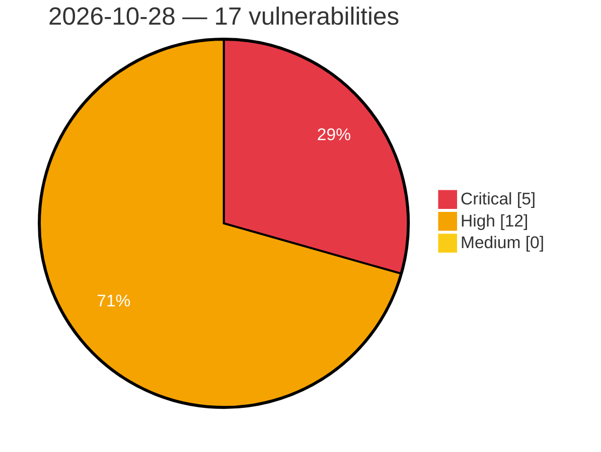

# Critical, High & Medium Severity Vulnerabilities — 2026-10-28

**Source status for this day:**

| Source | Critical | High | Medium | Total |
|--------|---------:|-----:|-------:|------:|
| cvefeed.io (High/Critical) | 5 | 12 | 0 | 17 |

**KEV (actively exploited):** 0  **Watchlist matches:** 12

## Critical (5)

| CVSS | Flags | Source | CVE / Title | Reported |
|------|-------|--------|-------------|----------|
| 9.8 | — | cvefeed.io (High/Critical) | [CVE-2026-110879 - jackson-databind: PolymorphicTypeValidator bypass via generic type arguments and array element types allows arbitrary class instantiation (incomplete fix for CVE-2026-54512)](https://cvefeed.io/vuln/detail/CVE-2026-110879) | 55 minutes ago |
| 9.8 | ⭐ | cvefeed.io (High/Critical) | [CVE-2026-84999 - Pie Register Premium <= 3.8.4.0 - Unauthenticated Arbitrary File Upload via piereg_file_upload AJAX Handler](https://cvefeed.io/vuln/detail/CVE-2026-84999) | 2 hours, 31 minutes ago |
| 9.8 | ⭐ | cvefeed.io (High/Critical) | [CVE-2026-106013 - Jupiter X Core <= 4.61.0 - Unauthenticated Authentication Bypass via Twitter/X Social Login oauth_verifier Parameter](https://cvefeed.io/vuln/detail/CVE-2026-106013) | 3 hours, 32 minutes ago |
| 9.4 | ⭐ | cvefeed.io (High/Critical) | [CVE-2026-104383 - Code injection in EagleCloud Aquila on-premises version](https://cvefeed.io/vuln/detail/CVE-2026-104383) | 32 minutes ago |
| 9.2 | — | cvefeed.io (High/Critical) | [CVE-2026-118375 - llama.cpp b8841 before b11865 Stack-based Buffer Overflow via ggml-rpc RDMA rdma_recv()](https://cvefeed.io/vuln/detail/CVE-2026-118375) | 2 hours, 31 minutes ago |

## High (12)

| CVSS | Flags | Source | CVE / Title | Reported |
|------|-------|--------|-------------|----------|
| 8.8 | ⭐ | cvefeed.io (High/Critical) | [CVE-2026-1928 - Rank Math SEO <= 1.0.276 - Authenticated (Contributor+) PHP Object Injection to Remote Code Execution](https://cvefeed.io/vuln/detail/CVE-2026-1928) | 1 hour, 31 minutes ago |
| 8.8 | ⭐ | cvefeed.io (High/Critical) | [CVE-2015-20129 - CrushFTP before 7.3.0 Cross-Site Request Forgery via /WebInterface/function/](https://cvefeed.io/vuln/detail/CVE-2015-20129) | 2 hours, 31 minutes ago |
| 8.8 | ⭐ | cvefeed.io (High/Critical) | [CVE-2014-125138 - C97net qEngine CMS through 6.0.0, Kemana Directory through 1.5.6, Cart Engine through 3.0.0 Unrestricted File Upload via Image Fields](https://cvefeed.io/vuln/detail/CVE-2014-125138) | 2 hours, 31 minutes ago |
| 8.7 | ⭐ | cvefeed.io (High/Critical) | [CVE-2026-104384 - Insufficiently protected credentials in EagleCloud Aquila on-premises version](https://cvefeed.io/vuln/detail/CVE-2026-104384) | 32 minutes ago |
| 8.7 | — | cvefeed.io (High/Critical) | [CVE-2026-118377 - mews/pos through 2.0.0 Missing Hash Verification in 3D Pay and 3D Host Callbacks](https://cvefeed.io/vuln/detail/CVE-2026-118377) | 2 hours, 31 minutes ago |
| 8.6 | ⭐ | cvefeed.io (High/Critical) | [CVE-2026-117607 - Xerte Online Toolkits through 3.15.5 RCE via Language Pack Import](https://cvefeed.io/vuln/detail/CVE-2026-117607) | 2 hours, 31 minutes ago |
| 8.6 | ⭐ | cvefeed.io (High/Critical) | [CVE-2013-20007 - Linksys WAG200G through 1.01.06 OS Command Injection via timer_interval in setup.cgi](https://cvefeed.io/vuln/detail/CVE-2013-20007) | 2 hours, 31 minutes ago |
| 8.5 | ⭐ | cvefeed.io (High/Critical) | [CVE-2026-118378 - Tabularis before 0.28.0 SQL Injection via MCP describe_table table_name](https://cvefeed.io/vuln/detail/CVE-2026-118378) | 2 hours, 31 minutes ago |
| 8.2 | ⭐ | cvefeed.io (High/Critical) | [CVE-2026-118374 - LibreSSL ocspcheck through 4.4.0 Memory Exhaustion via Unbounded OCSP HTTP Response](https://cvefeed.io/vuln/detail/CVE-2026-118374) | 2 hours, 31 minutes ago |
| 8.2 | — | cvefeed.io (High/Critical) | [CVE-2026-118370 - libexpat through 2.9.0 Integer Overflow in storeAtts via attIndex and nPrefixes](https://cvefeed.io/vuln/detail/CVE-2026-118370) | 2 hours, 31 minutes ago |
| 8.2 | ⭐ | cvefeed.io (High/Critical) | [CVE-2026-117610 - libexpat through 2.9.0 NULL Pointer Dereference via External Entity Subparser](https://cvefeed.io/vuln/detail/CVE-2026-117610) | 2 hours, 31 minutes ago |
| 8.2 | — | cvefeed.io (High/Critical) | [CVE-2014-125136 - C97net qEngine CMS through 6.0.0, Kemana Directory through 1.5.6, Cart Engine through 3.0.0 Database Backup Exposure via /admin/backup](https://cvefeed.io/vuln/detail/CVE-2014-125136) | 2 hours, 31 minutes ago |
