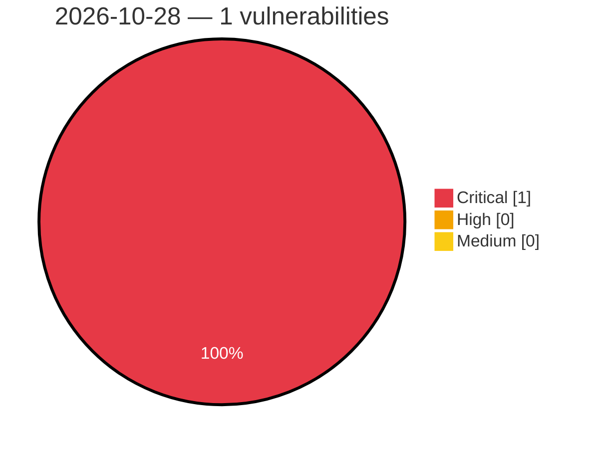

# Critical, High & Medium Severity Vulnerabilities — 2026-10-28

**Source status for this day:**

| Source | Critical | High | Medium | Total |
|--------|---------:|-----:|-------:|------:|
| cvefeed.io (High/Critical) | 1 | 0 | 0 | 1 |

**KEV (actively exploited):** 0  **Watchlist matches:** 0

## Critical (1)

| CVSS | Flags | Source | CVE / Title | Reported |
|------|-------|--------|-------------|----------|
| 9.8 | — | cvefeed.io (High/Critical) | [CVE-2026-110879 - jackson-databind: PolymorphicTypeValidator bypass via generic type arguments and array element types allows arbitrary class instantiation (incomplete fix for CVE-2026-54512)](https://cvefeed.io/vuln/detail/CVE-2026-110879) | 55 minutes ago |
