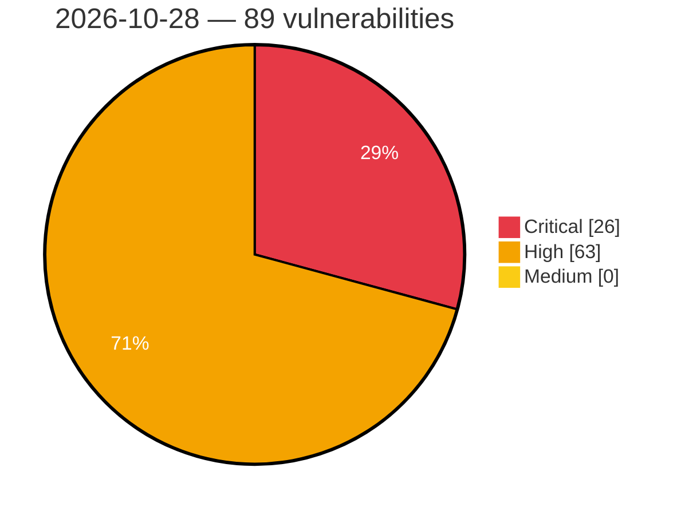

# Critical, High & Medium Severity Vulnerabilities — 2026-10-28

**Source status for this day:**

| Source | Critical | High | Medium | Total |
|--------|---------:|-----:|-------:|------:|
| cvefeed.io (High/Critical) | 26 | 63 | 0 | 89 |

**KEV (actively exploited):** 0  **Watchlist matches:** 59

## Critical (26)

| CVSS | Flags | Source | CVE / Title | Reported |
|------|-------|--------|-------------|----------|
| 10.0 | ⭐ | cvefeed.io (High/Critical) | [CVE-2026-61567 - AVideo-Encoder: unauthenticated command execution through streamer login trust](https://cvefeed.io/vuln/detail/CVE-2026-61567) | 3 hours, 28 minutes ago |
| 10.0 | ⭐ | cvefeed.io (High/Critical) | [CVE-2026-61564 - AVideo-Encoder: unauthenticated installer PHP code injection](https://cvefeed.io/vuln/detail/CVE-2026-61564) | 3 hours, 28 minutes ago |
| 9.8 | — | cvefeed.io (High/Critical) | [CVE-2026-110879 - jackson-databind: PolymorphicTypeValidator bypass via generic type arguments and array element types allows arbitrary class instantiation (incomplete fix for CVE-2026-54512)](https://cvefeed.io/vuln/detail/CVE-2026-110879) | 55 minutes ago |
| 9.8 | ⭐ | cvefeed.io (High/Critical) | [CVE-2026-84999 - Pie Register Premium <= 3.8.4.0 - Unauthenticated Arbitrary File Upload via piereg_file_upload AJAX Handler](https://cvefeed.io/vuln/detail/CVE-2026-84999) | 2 hours, 31 minutes ago |
| 9.8 | ⭐ | cvefeed.io (High/Critical) | [CVE-2026-106013 - Jupiter X Core <= 4.61.0 - Unauthenticated Authentication Bypass via Twitter/X Social Login oauth_verifier Parameter](https://cvefeed.io/vuln/detail/CVE-2026-106013) | 3 hours, 32 minutes ago |
| 9.8 | ⭐ | cvefeed.io (High/Critical) | [CVE-2026-118477 - KaliFast Project Management Platform ei_git_repo_url OS Command Injection](https://cvefeed.io/vuln/detail/CVE-2026-118477) | 1 hour, 51 minutes ago |
| 9.8 | ⭐ | cvefeed.io (High/Critical) | [CVE-2026-114278 - Unauthenticated Command Injection via kubeconfig Username in che-machine-exec](https://cvefeed.io/vuln/detail/CVE-2026-114278) | 1 hour, 51 minutes ago |
| 9.8 | — | cvefeed.io (High/Critical) | [CVE-2026-103780 - Dell PowerProtect Data Domain Stack-based Buffer Overflow Vulnerability](https://cvefeed.io/vuln/detail/CVE-2026-103780) | 2 hours, 51 minutes ago |
| 9.8 | — | cvefeed.io (High/Critical) | [CVE-2026-86384 - Dell PowerProtect Data Domain Use of Hard-coded Cryptographic Key Vulnerability](https://cvefeed.io/vuln/detail/CVE-2026-86384) | 3 hours, 51 minutes ago |
| 9.8 | ⭐ | cvefeed.io (High/Critical) | [CVE-2026-118690 - Signal K Server before 2.33.0 Missing Authentication via /skServer/ziplogs](https://cvefeed.io/vuln/detail/CVE-2026-118690) | 39 minutes ago |
| 9.6 | ⭐ | cvefeed.io (High/Critical) | [CVE-2026-115904 - Topluyo Desktop for Linux has an OS Command Injection issue](https://cvefeed.io/vuln/detail/CVE-2026-115904) | 51 minutes ago |
| 9.6 | — | cvefeed.io (High/Critical) | [CVE-2026-103799 - Dell PowerProtect Data Domain Management Center Missing Authorization Vulnerability](https://cvefeed.io/vuln/detail/CVE-2026-103799) | 2 hours, 51 minutes ago |
| 9.6 | ⭐ | cvefeed.io (High/Critical) | [CVE-2026-103792 - Dell PowerProtect Data Domain Management Center SQL Injection Vulnerability](https://cvefeed.io/vuln/detail/CVE-2026-103792) | 2 hours, 51 minutes ago |
| 9.4 | ⭐ | cvefeed.io (High/Critical) | [CVE-2026-104383 - Code injection in EagleCloud Aquila on-premises version](https://cvefeed.io/vuln/detail/CVE-2026-104383) | 32 minutes ago |
| 9.4 | ⭐ | cvefeed.io (High/Critical) | [CVE-2026-105420 - Path Traversal in Wing WFTP Server leading to Remote Code Execution](https://cvefeed.io/vuln/detail/CVE-2026-105420) | 49 minutes ago |
| 9.4 | — | cvefeed.io (High/Critical) | [CVE-2026-112197 - Missing Authentication for Critical Function in Tactis' NoviGest Desktop App](https://cvefeed.io/vuln/detail/CVE-2026-112197) | 2 hours, 51 minutes ago |
| 9.4 | ⭐ | cvefeed.io (High/Critical) | [CVE-2026-63190 - FearlessCMS: Unauthenticated debug scripts expose filesystem operations and XSS](https://cvefeed.io/vuln/detail/CVE-2026-63190) | 1 hour, 32 minutes ago |
| 9.3 | ⭐ | cvefeed.io (High/Critical) | [CVE-2026-115607 - WordPress DXP ToolKit plugin <= 2.0.1 - SQL Injection vulnerability](https://cvefeed.io/vuln/detail/CVE-2026-115607) | 51 minutes ago |
| 9.3 | ⭐ | cvefeed.io (High/Critical) | [CVE-2026-111411 - WordPress FunnelKit Automations plugin <= 3.8.5.2 - SQL Injection vulnerability](https://cvefeed.io/vuln/detail/CVE-2026-111411) | 51 minutes ago |
| 9.2 | — | cvefeed.io (High/Critical) | [CVE-2026-118375 - llama.cpp b8841 before b11865 Stack-based Buffer Overflow via ggml-rpc RDMA rdma_recv()](https://cvefeed.io/vuln/detail/CVE-2026-118375) | 2 hours, 31 minutes ago |
| 9.2 | ⭐ | cvefeed.io (High/Critical) | [CVE-2026-118633 - Sophos UTM Path Traversal Remote Code Execution](https://cvefeed.io/vuln/detail/CVE-2026-118633) | 21 minutes ago |
| 9.1 | ⭐ | cvefeed.io (High/Critical) | [CVE-2026-67074 - HCL BigFix AEX is affected by multiple security vulnerabilities.](https://cvefeed.io/vuln/detail/CVE-2026-67074) | 51 minutes ago |
| 9.1 | ⭐ | cvefeed.io (High/Critical) | [CVE-2026-14571 - SQL injection (SQLi) in the user authentication module of Futurum Software](https://cvefeed.io/vuln/detail/CVE-2026-14571) | 3 hours, 51 minutes ago |
| 9.1 | ⭐ | cvefeed.io (High/Critical) | [CVE-2026-90717 - Dell PowerProtect Data Domain Management Center Authentication Bypass Vulnerability](https://cvefeed.io/vuln/detail/CVE-2026-90717) | 4 hours, 51 minutes ago |
| 9.1 | ⭐ | cvefeed.io (High/Critical) | [CVE-2026-118264 - Echo: Rejected WebSocket upgrades can bypass Echo route-level access controls](https://cvefeed.io/vuln/detail/CVE-2026-118264) | 21 minutes ago |
| 9.1 | ⭐ | cvefeed.io (High/Critical) | [CVE-2026-117574 - Ai-gateway-payload-processing: ai-gateway-payload-processing: tenant/credential selection from client-controlled url path with no in-process authorization](https://cvefeed.io/vuln/detail/CVE-2026-117574) | 1 hour, 33 minutes ago |

## High (63)

| CVSS | Flags | Source | CVE / Title | Reported |
|------|-------|--------|-------------|----------|
| 10.0 | — | cvefeed.io (High/Critical) | [CVE-2026-118579 - D-Link DIR-505 Web Management CGI secmark1524.cgi main backdoor](https://cvefeed.io/vuln/detail/CVE-2026-118579) | 2 hours, 28 minutes ago |
| 8.8 | ⭐ | cvefeed.io (High/Critical) | [CVE-2026-1928 - Rank Math SEO <= 1.0.276 - Authenticated (Contributor+) PHP Object Injection to Remote Code Execution](https://cvefeed.io/vuln/detail/CVE-2026-1928) | 1 hour, 31 minutes ago |
| 8.8 | ⭐ | cvefeed.io (High/Critical) | [CVE-2015-20129 - CrushFTP before 7.3.0 Cross-Site Request Forgery via /WebInterface/function/](https://cvefeed.io/vuln/detail/CVE-2015-20129) | 2 hours, 31 minutes ago |
| 8.8 | ⭐ | cvefeed.io (High/Critical) | [CVE-2014-125138 - C97net qEngine CMS through 6.0.0, Kemana Directory through 1.5.6, Cart Engine through 3.0.0 Unrestricted File Upload via Image Fields](https://cvefeed.io/vuln/detail/CVE-2014-125138) | 2 hours, 31 minutes ago |
| 8.8 | ⭐ | cvefeed.io (High/Critical) | [CVE-2026-116391 - WordPress GS Logo Slider plugin <= 3.8.9 - PHP Object Injection vulnerability](https://cvefeed.io/vuln/detail/CVE-2026-116391) | 51 minutes ago |
| 8.8 | — | cvefeed.io (High/Critical) | [CVE-2026-86378 - Dell PowerProtect Data Domain Stack-based Buffer Overflow Vulnerability](https://cvefeed.io/vuln/detail/CVE-2026-86378) | 2 hours, 51 minutes ago |
| 8.8 | — | cvefeed.io (High/Critical) | [CVE-2026-86385 - Dell PowerProtect Data Domain Improper Privilege Management Vulnerability](https://cvefeed.io/vuln/detail/CVE-2026-86385) | 3 hours, 51 minutes ago |
| 8.8 | ⭐ | cvefeed.io (High/Critical) | [CVE-2026-78674 - Remote Code Execution via BPMN System REST APIs in Multiple WSO2 Products Permits Arbitrary Command Execution](https://cvefeed.io/vuln/detail/CVE-2026-78674) | 17 minutes ago |
| 8.8 | ⭐ | cvefeed.io (High/Critical) | [CVE-2026-118688 - Wasmtime before 36.0.18, 37.0.0 before 48.0.6, and 49.0.0 before 49.0.3 Sandbox Escape via Symlink Rename](https://cvefeed.io/vuln/detail/CVE-2026-118688) | 21 minutes ago |
| 8.8 | ⭐ | cvefeed.io (High/Critical) | [CVE-2026-118683 - MONAI 1.2.0 before 1.6.1 Code Execution via bundle configs/logging.conf](https://cvefeed.io/vuln/detail/CVE-2026-118683) | 21 minutes ago |
| 8.8 | ⭐ | cvefeed.io (High/Critical) | [CVE-2026-61546 - AnkiMCP: DNS rebinding reaches unauthenticated local AnkiMCP HTTP tools](https://cvefeed.io/vuln/detail/CVE-2026-61546) | 3 hours, 28 minutes ago |
| 8.7 | ⭐ | cvefeed.io (High/Critical) | [CVE-2026-104384 - Insufficiently protected credentials in EagleCloud Aquila on-premises version](https://cvefeed.io/vuln/detail/CVE-2026-104384) | 32 minutes ago |
| 8.7 | — | cvefeed.io (High/Critical) | [CVE-2026-118377 - mews/pos through 2.0.0 Missing Hash Verification in 3D Pay and 3D Host Callbacks](https://cvefeed.io/vuln/detail/CVE-2026-118377) | 2 hours, 31 minutes ago |
| 8.7 | ⭐ | cvefeed.io (High/Critical) | [CVE-2026-116078 - HTTP/2 request bodies made of 1-byte DATA frames amplify memory use in Bandit](https://cvefeed.io/vuln/detail/CVE-2026-116078) | 42 minutes ago |
| 8.7 | ⭐ | cvefeed.io (High/Critical) | [CVE-2026-118686 - EspoCRM before 9.3.11 and 10.0.8 Unauthenticated Denial of Service via Password-Redaction Regex](https://cvefeed.io/vuln/detail/CVE-2026-118686) | 21 minutes ago |
| 8.7 | — | cvefeed.io (High/Critical) | [CVE-2026-118649 - n8n before 2.43.5 and 2.44.1 Authorization Bypass via Crafted Workflow ID in Data Tables](https://cvefeed.io/vuln/detail/CVE-2026-118649) | 21 minutes ago |
| 8.7 | ⭐ | cvefeed.io (High/Critical) | [CVE-2026-118645 - n8n before 1.123.85, 2.43.5, and 2.44.1 Filter Injection via Quick Base Node Where Parameter](https://cvefeed.io/vuln/detail/CVE-2026-118645) | 21 minutes ago |
| 8.7 | — | cvefeed.io (High/Critical) | [CVE-2026-118694 - python-markdown2 through 2.5.5 Denial of Service via Unclosed Inline Link Destinations](https://cvefeed.io/vuln/detail/CVE-2026-118694) | 3 hours, 28 minutes ago |
| 8.7 | — | cvefeed.io (High/Critical) | [CVE-2026-118689 - OvenMediaEngine through 0.21.0 OVT Relay DoS via Oversized payload_length](https://cvefeed.io/vuln/detail/CVE-2026-118689) | 3 hours, 28 minutes ago |
| 8.6 | ⭐ | cvefeed.io (High/Critical) | [CVE-2026-117607 - Xerte Online Toolkits through 3.15.5 RCE via Language Pack Import](https://cvefeed.io/vuln/detail/CVE-2026-117607) | 2 hours, 31 minutes ago |
| 8.6 | ⭐ | cvefeed.io (High/Critical) | [CVE-2013-20007 - Linksys WAG200G through 1.01.06 OS Command Injection via timer_interval in setup.cgi](https://cvefeed.io/vuln/detail/CVE-2013-20007) | 2 hours, 31 minutes ago |
| 8.6 | ⭐ | cvefeed.io (High/Critical) | [CVE-2026-67073 - HCL BigFix AEX is affected by multiple security vulnerabilities.](https://cvefeed.io/vuln/detail/CVE-2026-67073) | 51 minutes ago |
| 8.6 | ⭐ | cvefeed.io (High/Critical) | [CVE-2026-102790 - Joomla Extension - icagenda.com -  Authenticated Stored XSS in iCagenda 4.0.8 to 4.0.12](https://cvefeed.io/vuln/detail/CVE-2026-102790) | 1 hour, 51 minutes ago |
| 8.6 | — | cvefeed.io (High/Critical) | [CVE-2026-118254 - Highcharts Grid: pagination language options are parsed as HTML](https://cvefeed.io/vuln/detail/CVE-2026-118254) | 21 minutes ago |
| 8.6 | ⭐ | cvefeed.io (High/Critical) | [CVE-2026-118668 - LangGraph JavaScript custom authentication may permit cross-user Store access](https://cvefeed.io/vuln/detail/CVE-2026-118668) | 33 minutes ago |
| 8.6 | ⭐ | cvefeed.io (High/Critical) | [CVE-2026-118660 - Happy DOM: SSRF via iframe and link stylesheet when parsing untrusted HTML](https://cvefeed.io/vuln/detail/CVE-2026-118660) | 33 minutes ago |
| 8.6 | — | cvefeed.io (High/Critical) | [CVE-2026-76418 - Cisco Secure Firewall Adaptive Security Appliance and Secure Firewall Threat Defense Software Remote Access SSL VPN Tunnel Denial of Service Vulnerability](https://cvefeed.io/vuln/detail/CVE-2026-76418) | 1 hour, 31 minutes ago |
| 8.6 | — | cvefeed.io (High/Critical) | [CVE-2026-61542 - Gearboy advisory / Gearsystem body: Unauthenticated network exposure of MCP HTTP tools](https://cvefeed.io/vuln/detail/CVE-2026-61542) | 1 hour, 32 minutes ago |
| 8.6 | ⭐ | cvefeed.io (High/Critical) | [CVE-2026-61572 - AVideo-Encoder: unauthenticated full-response server-side request forgery](https://cvefeed.io/vuln/detail/CVE-2026-61572) | 3 hours, 28 minutes ago |
| 8.6 | ⭐ | cvefeed.io (High/Critical) | [CVE-2026-118755 - Volmarg Personal Management System through 2.1.0 OS Command Injection via Storage Folder Path](https://cvefeed.io/vuln/detail/CVE-2026-118755) | 3 hours, 28 minutes ago |
| 8.5 | ⭐ | cvefeed.io (High/Critical) | [CVE-2026-118378 - Tabularis before 0.28.0 SQL Injection via MCP describe_table table_name](https://cvefeed.io/vuln/detail/CVE-2026-118378) | 2 hours, 31 minutes ago |
| 8.5 | ⭐ | cvefeed.io (High/Critical) | [CVE-2026-111850 - WordPress BuddyPress plugin <= 14.5.2 - SQL Injection vulnerability](https://cvefeed.io/vuln/detail/CVE-2026-111850) | 51 minutes ago |
| 8.5 | — | cvefeed.io (High/Critical) | [CVE-2026-93517 - X.Org Server GLX RenderLarge Heap Buffer Overflow](https://cvefeed.io/vuln/detail/CVE-2026-93517) | 52 minutes ago |
| 8.5 | — | cvefeed.io (High/Critical) | [CVE-2026-118753 - FreeImage (danoli3 fork) before 3.19.25 Heap Buffer Overflow via GIF_PLAYBACK Compositing](https://cvefeed.io/vuln/detail/CVE-2026-118753) | 3 hours, 28 minutes ago |
| 8.5 | — | cvefeed.io (High/Critical) | [CVE-2026-118752 - FreeImage before 3.19.22 Heap Buffer Overflow via IFF/LBM PBM RLE Decoder](https://cvefeed.io/vuln/detail/CVE-2026-118752) | 3 hours, 28 minutes ago |
| 8.4 | ⭐ | cvefeed.io (High/Critical) | [CVE-2026-118648 - n8n before 1.123.85, 2.43.5, and 2.44.1 Stored XSS via Webhook Responses Missing Sandbox Policy](https://cvefeed.io/vuln/detail/CVE-2026-118648) | 21 minutes ago |
| 8.4 | — | cvefeed.io (High/Critical) | [CVE-2026-118255 - Highcharts Grid: javascript: URL in credits.href runs script on click](https://cvefeed.io/vuln/detail/CVE-2026-118255) | 21 minutes ago |
| 8.4 | — | cvefeed.io (High/Critical) | [CVE-2026-118253 - Highcharts Dashboards: fullscreen labels are parsed as HTML](https://cvefeed.io/vuln/detail/CVE-2026-118253) | 21 minutes ago |
| 8.4 | — | cvefeed.io (High/Critical) | [CVE-2026-118252 - Highcharts Dashboards: sidebar component labels are parsed as HTML](https://cvefeed.io/vuln/detail/CVE-2026-118252) | 21 minutes ago |
| 8.4 | — | cvefeed.io (High/Critical) | [CVE-2026-118251 - Highcharts: javascript: URL in credits.href runs script on click](https://cvefeed.io/vuln/detail/CVE-2026-118251) | 21 minutes ago |
| 8.4 | — | cvefeed.io (High/Critical) | [CVE-2026-118246 - Highcharts Core: `breadcrumbs.style` keys become SVG event-handler attributes](https://cvefeed.io/vuln/detail/CVE-2026-118246) | 1 hour, 21 minutes ago |
| 8.4 | ⭐ | cvefeed.io (High/Critical) | [CVE-2026-118669 - OAuthLib: Token grants can use attacker-supplied client_id for authorization after authenticating a different client](https://cvefeed.io/vuln/detail/CVE-2026-118669) | 3 hours, 28 minutes ago |
| 8.3 | ⭐ | cvefeed.io (High/Critical) | [CVE-2026-112198 - Improper Restriction of XML External Entity Reference in Tactis' NoviGest Desktop App](https://cvefeed.io/vuln/detail/CVE-2026-112198) | 2 hours, 51 minutes ago |
| 8.3 | — | cvefeed.io (High/Critical) | [CVE-2026-103779 - Dell PowerProtect Data Domain Improper Authentication Vulnerability](https://cvefeed.io/vuln/detail/CVE-2026-103779) | 2 hours, 51 minutes ago |
| 8.3 | ⭐ | cvefeed.io (High/Critical) | [CVE-2025-14260 - Server Side Request Forgery in Multiple WSO2 Products Allows Access to Internal and External Resources](https://cvefeed.io/vuln/detail/CVE-2025-14260) | 17 minutes ago |
| 8.3 | ⭐ | cvefeed.io (High/Critical) | [CVE-2026-118687 - Coder before 2.29.21, 2.34.12, 2.35.9, 2.36.7, and 2.37.4 Missing Audience Validation in GCP Instance-Identity Authentication](https://cvefeed.io/vuln/detail/CVE-2026-118687) | 21 minutes ago |
| 8.2 | ⭐ | cvefeed.io (High/Critical) | [CVE-2026-118374 - LibreSSL ocspcheck through 4.4.0 Memory Exhaustion via Unbounded OCSP HTTP Response](https://cvefeed.io/vuln/detail/CVE-2026-118374) | 2 hours, 31 minutes ago |
| 8.2 | — | cvefeed.io (High/Critical) | [CVE-2026-118370 - libexpat through 2.9.0 Integer Overflow in storeAtts via attIndex and nPrefixes](https://cvefeed.io/vuln/detail/CVE-2026-118370) | 2 hours, 31 minutes ago |
| 8.2 | ⭐ | cvefeed.io (High/Critical) | [CVE-2026-117610 - libexpat through 2.9.0 NULL Pointer Dereference via External Entity Subparser](https://cvefeed.io/vuln/detail/CVE-2026-117610) | 2 hours, 31 minutes ago |
| 8.2 | — | cvefeed.io (High/Critical) | [CVE-2014-125136 - C97net qEngine CMS through 6.0.0, Kemana Directory through 1.5.6, Cart Engine through 3.0.0 Database Backup Exposure via /admin/backup](https://cvefeed.io/vuln/detail/CVE-2014-125136) | 2 hours, 31 minutes ago |
| 8.2 | — | cvefeed.io (High/Critical) | [CVE-2026-118684 - MONAI before 1.6.1 Missing Integrity Verification via check_hash in Downloads](https://cvefeed.io/vuln/detail/CVE-2026-118684) | 21 minutes ago |
| 8.2 | ⭐ | cvefeed.io (High/Critical) | [CVE-2026-118647 - n8n before 1.123.85, 2.43.5, and 2.44.1 SeaTable Trigger API Token Exposure via Execution Data](https://cvefeed.io/vuln/detail/CVE-2026-118647) | 21 minutes ago |
| 8.2 | ⭐ | cvefeed.io (High/Critical) | [CVE-2026-118643 - n8n before 1.123.85, 2.43.5, and 2.44.1 Credential Exposure via Node Execution Error Data](https://cvefeed.io/vuln/detail/CVE-2026-118643) | 21 minutes ago |
| 8.2 | ⭐ | cvefeed.io (High/Critical) | [CVE-2026-118262 - Echo: WebSocket proxy can retain connections and handlers after client disconnect](https://cvefeed.io/vuln/detail/CVE-2026-118262) | 21 minutes ago |
| 8.2 | — | cvefeed.io (High/Critical) | [CVE-2026-118261 - Echo: Decompress permits unbounded gzip expansion in v4](https://cvefeed.io/vuln/detail/CVE-2026-118261) | 21 minutes ago |
| 8.2 | — | cvefeed.io (High/Critical) | [CVE-2026-118260 - Echo: BodyDump captures request and response bodies without size limits in v4](https://cvefeed.io/vuln/detail/CVE-2026-118260) | 21 minutes ago |
| 8.2 | ⭐ | cvefeed.io (High/Critical) | [CVE-2026-118665 - GraphQL Tools: Per-request connection parameters persist into later users' WebSocket authentications](https://cvefeed.io/vuln/detail/CVE-2026-118665) | 33 minutes ago |
| 8.2 | ⭐ | cvefeed.io (High/Critical) | [CVE-2026-118664 - decode-uri-component: Denial of service via quadratic replacement of percent-encoded runs](https://cvefeed.io/vuln/detail/CVE-2026-118664) | 33 minutes ago |
| 8.1 | ⭐ | cvefeed.io (High/Critical) | [CVE-2026-118485 - Axel Download Accelerator Path Traversal via URL Filename Decoding](https://cvefeed.io/vuln/detail/CVE-2026-118485) | 1 hour, 51 minutes ago |
| 8.1 | ⭐ | cvefeed.io (High/Critical) | [CVE-2026-109411 - Samba: access control bypass via vfs_ceph_rgw case-insensitive open](https://cvefeed.io/vuln/detail/CVE-2026-109411) | 21 minutes ago |
| 8.1 | ⭐ | cvefeed.io (High/Critical) | [CVE-2026-84725 - Openjdk-orb: incomplete fix for cve-2026-15560,unauthed class loading via iiop in eap](https://cvefeed.io/vuln/detail/CVE-2026-84725) | 1 hour, 21 minutes ago |
| 8.1 | ⭐ | cvefeed.io (High/Critical) | [CVE-2026-85749 - MailWatch: IDOR lets any authenticated user release or delete another tenant's quarantined mail](https://cvefeed.io/vuln/detail/CVE-2026-85749) | 2 hours, 28 minutes ago |
| 8.0 | ⭐ | cvefeed.io (High/Critical) | [CVE-2026-93851 - Path traversal in Mattermost Agents plugin mention reminder allows plugin replacement via crafted post](https://cvefeed.io/vuln/detail/CVE-2026-93851) | 9 minutes ago |
