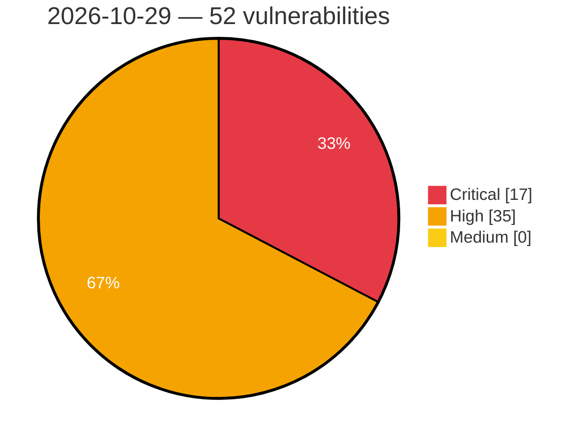

# Critical, High & Medium Severity Vulnerabilities — 2026-10-29

**Source status for this day:**

| Source | Critical | High | Medium | Total |
|--------|---------:|-----:|-------:|------:|
| cvefeed.io (High/Critical) | 17 | 35 | 0 | 52 |

**KEV (actively exploited):** 0  **Watchlist matches:** 26

## Critical (17)

| CVSS | Flags | Source | CVE / Title | Reported |
|------|-------|--------|-------------|----------|
| 10.0 | — | cvefeed.io (High/Critical) | [CVE-2026-84295 - Improper Authentication in Progress WS_FTP Server](https://cvefeed.io/vuln/detail/CVE-2026-84295) | 33 minutes ago |
| 9.9 | ⭐ | cvefeed.io (High/Critical) | [CVE-2026-119145 - Frappe before 15.121.0 and 16.x before 16.34.0 Path Traversal RCE via File Upload](https://cvefeed.io/vuln/detail/CVE-2026-119145) | 20 minutes ago |
| 9.9 | ⭐ | cvefeed.io (High/Critical) | [CVE-2026-90868 - OS Command Injection in Progress WS_FTP Server](https://cvefeed.io/vuln/detail/CVE-2026-90868) | 24 minutes ago |
| 9.8 | ⭐ | cvefeed.io (High/Critical) | [CVE-2026-42922 - FUXA Authorization Bypass and Remote Code Execution](https://cvefeed.io/vuln/detail/CVE-2026-42922) | 4 hours, 4 minutes ago |
| 9.8 | ⭐ | cvefeed.io (High/Critical) | [CVE-2026-109516 - Bot for Telegram on WooCommerce <= 1.3.0 - Unauthenticated Authentication Bypass to Account Takeover via Fake Telegram Webhook + Brute-Forced Login Token](https://cvefeed.io/vuln/detail/CVE-2026-109516) | 4 hours, 5 minutes ago |
| 9.8 | — | cvefeed.io (High/Critical) | [CVE-2026-93680 - Langflow OSS is affected by multiple vulnerabilities](https://cvefeed.io/vuln/detail/CVE-2026-93680) | 3 hours, 30 minutes ago |
| 9.4 | — | cvefeed.io (High/Critical) | [CVE-2026-66088 - Unrestricted Command Execution via system.execute](https://cvefeed.io/vuln/detail/CVE-2026-66088) | 9 minutes ago |
| 9.4 | — | cvefeed.io (High/Critical) | [CVE-2026-103093 - Sandbox Escape via Table Rotation in ServiceNow AI Platform](https://cvefeed.io/vuln/detail/CVE-2026-103093) | 33 minutes ago |
| 9.3 | — | cvefeed.io (High/Critical) | [CVE-2026-111732 - Out-of-bounds write when parsing AR Vendor Block requests](https://cvefeed.io/vuln/detail/CVE-2026-111732) | 38 minutes ago |
| 9.3 | — | cvefeed.io (High/Critical) | [CVE-2026-118762 - Monkeytype: fork PR can execute code with elevated GITHUB_TOKEN](https://cvefeed.io/vuln/detail/CVE-2026-118762) | 2 hours, 32 minutes ago |
| 9.2 | — | cvefeed.io (High/Critical) | [CVE-2026-112256 - Logon bypass (trust of attacker-controlled completed-methods list)](https://cvefeed.io/vuln/detail/CVE-2026-112256) | 47 minutes ago |
| 9.2 | ⭐ | cvefeed.io (High/Critical) | [CVE-2026-118769 - Botan: Integer overflow when reporting block size in FFI can cause memory corruption](https://cvefeed.io/vuln/detail/CVE-2026-118769) | 1 hour, 33 minutes ago |
| 9.1 | ⭐ | cvefeed.io (High/Critical) | [CVE-2026-119128 - ZITADEL 4.0.0 before 4.19.5 Login V2 Account Takeover via Forgeable verificationCheck Cookie](https://cvefeed.io/vuln/detail/CVE-2026-119128) | 20 minutes ago |
| 9.1 | ⭐ | cvefeed.io (High/Critical) | [CVE-2026-90866 - Virtual Folder Path Confinement Bypass in Progress WS_FTP Server](https://cvefeed.io/vuln/detail/CVE-2026-90866) | 26 minutes ago |
| 9.1 | ⭐ | cvefeed.io (High/Critical) | [CVE-2026-90864 - Host Administrator Path Containment Bypass in Progress WS_FTP Server](https://cvefeed.io/vuln/detail/CVE-2026-90864) | 28 minutes ago |
| 9.1 | ⭐ | cvefeed.io (High/Critical) | [CVE-2026-90863 - Privilege Escalation via Missing Authorization in WS_FTP Manager](https://cvefeed.io/vuln/detail/CVE-2026-90863) | 29 minutes ago |
| 9.0 | ⭐ | cvefeed.io (High/Critical) | [CVE-2026-90865 - Command Injection via FTP Notification Variables in Progress WS_FTP Server](https://cvefeed.io/vuln/detail/CVE-2026-90865) | 27 minutes ago |

## High (35)

| CVSS | Flags | Source | CVE / Title | Reported |
|------|-------|--------|-------------|----------|
| 8.8 | — | cvefeed.io (High/Critical) | [CVE-2026-119144 - Frappe Framework before 15.111.0 and 16.x before 16.21.0 Server-Side Template Injection via Message Fields](https://cvefeed.io/vuln/detail/CVE-2026-119144) | 20 minutes ago |
| 8.8 | ⭐ | cvefeed.io (High/Critical) | [CVE-2026-118082 - WordPress Buddyboss Platform plugin <= 3.5.0 - Privilege Escalation vulnerability](https://cvefeed.io/vuln/detail/CVE-2026-118082) | 54 minutes ago |
| 8.8 | — | cvefeed.io (High/Critical) | [CVE-2026-118081 - WordPress 10Web Social Photo Feed plugin <= 1.5.6 - PHP Object Injection vulnerability](https://cvefeed.io/vuln/detail/CVE-2026-118081) | 54 minutes ago |
| 8.8 | — | cvefeed.io (High/Critical) | [CVE-2026-118080 - WordPress Social Snap plugin <= 1.5.4 - PHP Object Injection vulnerability](https://cvefeed.io/vuln/detail/CVE-2026-118080) | 54 minutes ago |
| 8.8 | — | cvefeed.io (High/Critical) | [CVE-2026-118076 - WordPress Frisbii Pay plugin <= 1.8.19 - PHP Object Injection vulnerability](https://cvefeed.io/vuln/detail/CVE-2026-118076) | 54 minutes ago |
| 8.8 | ⭐ | cvefeed.io (High/Critical) | [CVE-2026-119168 - Nomad allocation data migration may allow host directory permission modification via symlink following](https://cvefeed.io/vuln/detail/CVE-2026-119168) | 33 minutes ago |
| 8.8 | — | cvefeed.io (High/Critical) | [CVE-2026-96203 - Microsoft Edge (Chromium-based) Elevation of Privilege Vulnerability](https://cvefeed.io/vuln/detail/CVE-2026-96203) | 3 hours, 30 minutes ago |
| 8.8 | ⭐ | cvefeed.io (High/Critical) | [CVE-2026-96199 - Microsoft Edge (Chromium-based) Remote Code Execution Vulnerability](https://cvefeed.io/vuln/detail/CVE-2026-96199) | 3 hours, 30 minutes ago |
| 8.8 | ⭐ | cvefeed.io (High/Critical) | [CVE-2026-96198 - Microsoft Edge (Chromium-based) Remote Code Execution Vulnerability](https://cvefeed.io/vuln/detail/CVE-2026-96198) | 3 hours, 30 minutes ago |
| 8.8 | — | cvefeed.io (High/Critical) | [CVE-2026-96196 - Microsoft Edge (Chromium-based) Security Feature Bypass Vulnerability](https://cvefeed.io/vuln/detail/CVE-2026-96196) | 3 hours, 30 minutes ago |
| 8.8 | ⭐ | cvefeed.io (High/Critical) | [CVE-2026-96192 - Microsoft Edge (Chromium-based) Remote Code Execution Vulnerability](https://cvefeed.io/vuln/detail/CVE-2026-96192) | 3 hours, 30 minutes ago |
| 8.8 | — | cvefeed.io (High/Critical) | [CVE-2026-88077 - Microsoft Edge (Chromium-based) Elevation of Privilege Vulnerability](https://cvefeed.io/vuln/detail/CVE-2026-88077) | 3 hours, 31 minutes ago |
| 8.8 | ⭐ | cvefeed.io (High/Critical) | [CVE-2026-85897 - Microsoft Edge (Chromium-based) Remote Code Execution Vulnerability](https://cvefeed.io/vuln/detail/CVE-2026-85897) | 3 hours, 31 minutes ago |
| 8.7 | — | cvefeed.io (High/Critical) | [CVE-2025-62841 - Hard-coded Cryptographic Key #2](https://cvefeed.io/vuln/detail/CVE-2025-62841) | 43 minutes ago |
| 8.7 | — | cvefeed.io (High/Critical) | [CVE-2025-62839 - Hard-coded Cryptographic Key #1](https://cvefeed.io/vuln/detail/CVE-2025-62839) | 43 minutes ago |
| 8.7 | ⭐ | cvefeed.io (High/Critical) | [CVE-2026-119119 - Crawl4AI before 0.9.5 Denial of Service via Unbounded CrawlerRunConfig Delay Fields](https://cvefeed.io/vuln/detail/CVE-2026-119119) | 20 minutes ago |
| 8.7 | ⭐ | cvefeed.io (High/Critical) | [CVE-2026-115793 - Resource exhaustion from RPC sessions kept for requests to unknown interface](https://cvefeed.io/vuln/detail/CVE-2026-115793) | 34 minutes ago |
| 8.7 | — | cvefeed.io (High/Critical) | [CVE-2026-111736 - NULL pointer dereference on implicit read of user specific record index](https://cvefeed.io/vuln/detail/CVE-2026-111736) | 35 minutes ago |
| 8.7 | ⭐ | cvefeed.io (High/Critical) | [CVE-2026-112200 - Resource exhaustion from unreleased AR and RPC session on RPC requests with incorrect endianness](https://cvefeed.io/vuln/detail/CVE-2026-112200) | 35 minutes ago |
| 8.7 | — | cvefeed.io (High/Critical) | [CVE-2026-111733 - NULL pointer dereference on implicit read of AR specific record index](https://cvefeed.io/vuln/detail/CVE-2026-111733) | 36 minutes ago |
| 8.7 | — | cvefeed.io (High/Critical) | [CVE-2026-111731 - Infinite loop when reading PDPortDataCheck record of subslot 0](https://cvefeed.io/vuln/detail/CVE-2026-111731) | 39 minutes ago |
| 8.7 | — | cvefeed.io (High/Critical) | [CVE-2026-118764 - minimatch: potential denial of service via globparts amplification](https://cvefeed.io/vuln/detail/CVE-2026-118764) | 2 hours, 32 minutes ago |
| 8.6 | — | cvefeed.io (High/Critical) | [CVE-2026-113387 - Ortto WordPress Plugin Unauthenticated Configuration Injection Vulnerability](https://cvefeed.io/vuln/detail/CVE-2026-113387) | 5 minutes ago |
| 8.6 | ⭐ | cvefeed.io (High/Critical) | [CVE-2026-119129 - ZITADEL 3.0.0 through 3.4.15 and 4.0.0 before 4.19.5 Account Takeover via Device Authorization Approval](https://cvefeed.io/vuln/detail/CVE-2026-119129) | 20 minutes ago |
| 8.6 | — | cvefeed.io (High/Critical) | [CVE-2026-119127 - ZITADEL 4.0.0 before 4.19.5 Account Takeover via Login V2 Host Header Injection](https://cvefeed.io/vuln/detail/CVE-2026-119127) | 20 minutes ago |
| 8.6 | ⭐ | cvefeed.io (High/Critical) | [CVE-2023-7357 - FlexNet Publisher lmadmin Rogue Vendor Daemon Vulnerability](https://cvefeed.io/vuln/detail/CVE-2023-7357) | 2 hours, 33 minutes ago |
| 8.5 | ⭐ | cvefeed.io (High/Critical) | [CVE-2026-119115 - Incorrect authorization in issuer resolution in AWS Private CA Connector for Kubernetes](https://cvefeed.io/vuln/detail/CVE-2026-119115) | 2 hours, 32 minutes ago |
| 8.4 | — | cvefeed.io (High/Critical) | [CVE-2026-107347 - Nomad dispatch payload writes can escape the allocation directory through symlinks](https://cvefeed.io/vuln/detail/CVE-2026-107347) | 1 hour, 33 minutes ago |
| 8.3 | — | cvefeed.io (High/Critical) | [CVE-2026-21157 - Bixby Improper Input Validation Vulnerability](https://cvefeed.io/vuln/detail/CVE-2026-21157) | 28 minutes ago |
| 8.3 | ⭐ | cvefeed.io (High/Critical) | [CVE-2026-119118 - Crawl4AI before 0.9.5 Improper Certificate Validation via Hard-coded Chromium Flags](https://cvefeed.io/vuln/detail/CVE-2026-119118) | 20 minutes ago |
| 8.2 | — | cvefeed.io (High/Critical) | [CVE-2026-9535 - VTK ChacoReader Out-of-Bounds Read](https://cvefeed.io/vuln/detail/CVE-2026-9535) | 33 minutes ago |
| 8.2 | ⭐ | cvefeed.io (High/Critical) | [CVE-2026-93570 - XML External Entity injection in Szafir and Szafir Weryfikująca](https://cvefeed.io/vuln/detail/CVE-2026-93570) | 3 hours, 30 minutes ago |
| 8.1 | ⭐ | cvefeed.io (High/Critical) | [CVE-2026-96228 - SSL Wireless SMS Notification <= 3.8.1 - Unauthenticated Authentication Bypass to Account Takeover](https://cvefeed.io/vuln/detail/CVE-2026-96228) | 4 hours, 4 minutes ago |
| 8.1 | ⭐ | cvefeed.io (High/Critical) | [CVE-2026-90867 - Improper Access Control of Web Admin Console in Progress WS_FTP Server](https://cvefeed.io/vuln/detail/CVE-2026-90867) | 25 minutes ago |
| 8.1 | — | cvefeed.io (High/Critical) | [CVE-2026-85899 - Microsoft Edge (Chromium-based) Elevation of Privilege Vulnerability](https://cvefeed.io/vuln/detail/CVE-2026-85899) | 3 hours, 31 minutes ago |
