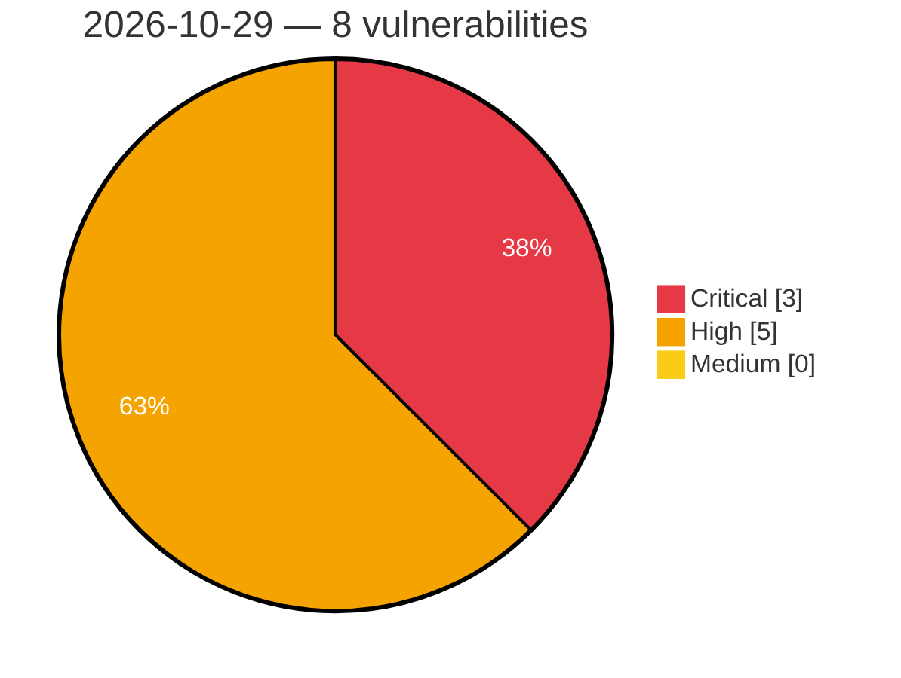

# Critical, High & Medium Severity Vulnerabilities — 2026-10-29

**Source status for this day:**

| Source | Critical | High | Medium | Total |
|--------|---------:|-----:|-------:|------:|
| cvefeed.io (High/Critical) | 3 | 5 | 0 | 8 |

**KEV (actively exploited):** 0  **Watchlist matches:** 3

## Critical (3)

| CVSS | Flags | Source | CVE / Title | Reported |
|------|-------|--------|-------------|----------|
| 9.8 | ⭐ | cvefeed.io (High/Critical) | [CVE-2026-42922 - FUXA Authorization Bypass and Remote Code Execution](https://cvefeed.io/vuln/detail/CVE-2026-42922) | 4 hours, 4 minutes ago |
| 9.8 | ⭐ | cvefeed.io (High/Critical) | [CVE-2026-109516 - Bot for Telegram on WooCommerce <= 1.3.0 - Unauthenticated Authentication Bypass to Account Takeover via Fake Telegram Webhook + Brute-Forced Login Token](https://cvefeed.io/vuln/detail/CVE-2026-109516) | 4 hours, 5 minutes ago |
| 9.4 | — | cvefeed.io (High/Critical) | [CVE-2026-66088 - Unrestricted Command Execution via system.execute](https://cvefeed.io/vuln/detail/CVE-2026-66088) | 9 minutes ago |

## High (5)

| CVSS | Flags | Source | CVE / Title | Reported |
|------|-------|--------|-------------|----------|
| 8.7 | — | cvefeed.io (High/Critical) | [CVE-2025-62841 - Hard-coded Cryptographic Key #2](https://cvefeed.io/vuln/detail/CVE-2025-62841) | 43 minutes ago |
| 8.7 | — | cvefeed.io (High/Critical) | [CVE-2025-62839 - Hard-coded Cryptographic Key #1](https://cvefeed.io/vuln/detail/CVE-2025-62839) | 43 minutes ago |
| 8.6 | — | cvefeed.io (High/Critical) | [CVE-2026-113387 - Ortto WordPress Plugin Unauthenticated Configuration Injection Vulnerability](https://cvefeed.io/vuln/detail/CVE-2026-113387) | 5 minutes ago |
| 8.3 | — | cvefeed.io (High/Critical) | [CVE-2026-21157 - Bixby Improper Input Validation Vulnerability](https://cvefeed.io/vuln/detail/CVE-2026-21157) | 28 minutes ago |
| 8.1 | ⭐ | cvefeed.io (High/Critical) | [CVE-2026-96228 - SSL Wireless SMS Notification <= 3.8.1 - Unauthenticated Authentication Bypass to Account Takeover](https://cvefeed.io/vuln/detail/CVE-2026-96228) | 4 hours, 4 minutes ago |
