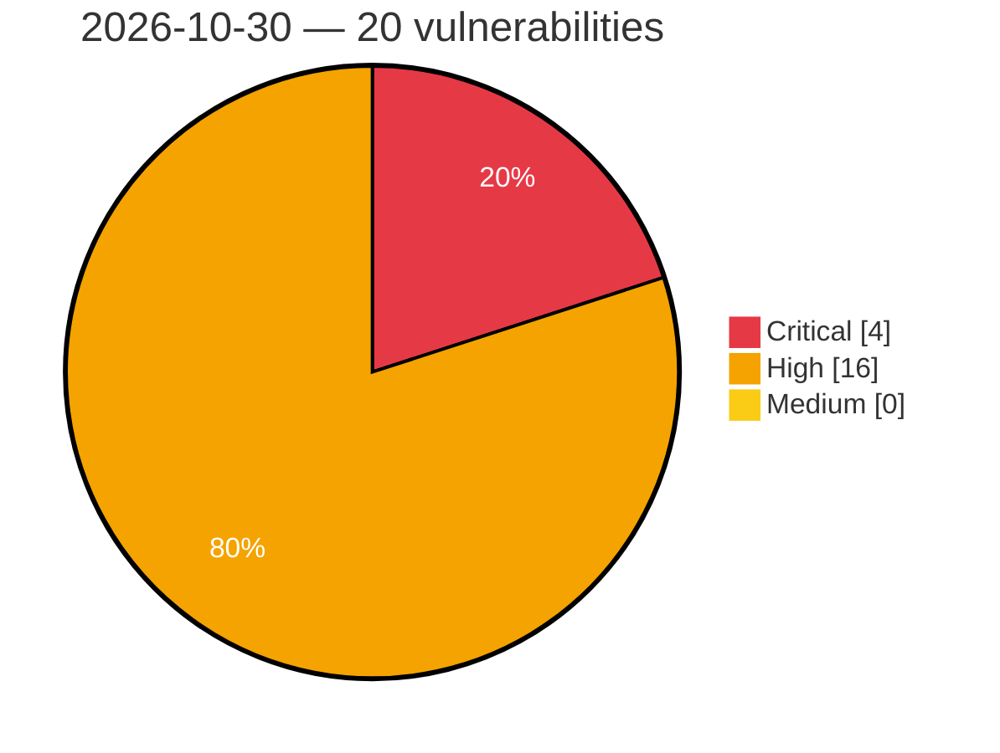

# Critical, High & Medium Severity Vulnerabilities — 2026-10-30

**Source status for this day:**

| Source | Critical | High | Medium | Total |
|--------|---------:|-----:|-------:|------:|
| cvefeed.io (High/Critical) | 4 | 16 | 0 | 20 |

**KEV (actively exploited):** 0  **Watchlist matches:** 15

## Critical (4)

| CVSS | Flags | Source | CVE / Title | Reported |
|------|-------|--------|-------------|----------|
| 9.8 | ⭐ | cvefeed.io (High/Critical) | [CVE-2025-31704 - Dahua Intelligent Connection Center command injection](https://cvefeed.io/vuln/detail/CVE-2025-31704) | 1 hour, 1 minute ago |
| 9.8 | ⭐ | cvefeed.io (High/Critical) | [CVE-2026-103039 - Gravity Forms <= 3.1.2 - Unauthenticated PHP Object Injection via Post Custom Field](https://cvefeed.io/vuln/detail/CVE-2026-103039) | 5 hours, 2 minutes ago |
| 9.5 | ⭐ | cvefeed.io (High/Critical) | [CVE-2026-116366 - Unauthenticated RCE vulnerability against ClickHouse Server](https://cvefeed.io/vuln/detail/CVE-2026-116366) | 1 hour, 1 minute ago |
| 9.4 | ⭐ | cvefeed.io (High/Critical) | [CVE-2026-82104 - API permission bypass via logic bug](https://cvefeed.io/vuln/detail/CVE-2026-82104) | 4 hours, 1 minute ago |

## High (16)

| CVSS | Flags | Source | CVE / Title | Reported |
|------|-------|--------|-------------|----------|
| 8.8 | ⭐ | cvefeed.io (High/Critical) | [CVE-2026-104368 - Export and Import Users and Customers <= 2.7.5 - Authenticated (Subscriber+) Privilege Escalation via CSV Escape-Character Mismatch in Export/Import Round Trip via Biographical Info Field](https://cvefeed.io/vuln/detail/CVE-2026-104368) | 1 hour, 52 minutes ago |
| 8.8 | ⭐ | cvefeed.io (High/Critical) | [CVE-2026-111505 - Dell OpenManage Enterprise OS Command Injection Vulnerability](https://cvefeed.io/vuln/detail/CVE-2026-111505) | 32 minutes ago |
| 8.8 | ⭐ | cvefeed.io (High/Critical) | [CVE-2026-119420 - Lago through 1.55.0 Authentication Bypass via acceptInvite GraphQL Mutation](https://cvefeed.io/vuln/detail/CVE-2026-119420) | 47 minutes ago |
| 8.8 | ⭐ | cvefeed.io (High/Critical) | [CVE-2026-119408 - n8n before 2.42.6, 2.43.3 and 3.0.1 Code Execution Outside Task Runner Isolation via Deprecated Function Nodes](https://cvefeed.io/vuln/detail/CVE-2026-119408) | 47 minutes ago |
| 8.8 | ⭐ | cvefeed.io (High/Critical) | [CVE-2026-59387 - Broken access control restriction in Cloud Controller API](https://cvefeed.io/vuln/detail/CVE-2026-59387) | 3 hours, 1 minute ago |
| 8.8 | — | cvefeed.io (High/Critical) | [CVE-2026-89435 - Formidable Forms <= 6.35 - Authenticated (Subscriber+) Arbitrary Plugin Installation via 'file_url' Parameter](https://cvefeed.io/vuln/detail/CVE-2026-89435) | 5 hours, 2 minutes ago |
| 8.7 | ⭐ | cvefeed.io (High/Critical) | [CVE-2026-85268 - Cross-Site Scripting (XSS) in Firebase Auth Handler via Malicious Bundle ID](https://cvefeed.io/vuln/detail/CVE-2026-85268) | 1 hour, 1 minute ago |
| 8.7 | — | cvefeed.io (High/Critical) | [CVE-2026-22110 - Missing authentication check on POST/PUT requests](https://cvefeed.io/vuln/detail/CVE-2026-22110) | 1 hour, 1 minute ago |
| 8.7 | — | cvefeed.io (High/Critical) | [CVE-2026-22105 - Use of default password based on serial number](https://cvefeed.io/vuln/detail/CVE-2026-22105) | 1 hour, 1 minute ago |
| 8.6 | — | cvefeed.io (High/Critical) | [CVE-2026-110972 - Use of Client-Side Authentication in Płatnik](https://cvefeed.io/vuln/detail/CVE-2026-110972) | 21 minutes ago |
| 8.4 | ⭐ | cvefeed.io (High/Critical) | [CVE-2025-68394 - SQL Injection in Protectel](https://cvefeed.io/vuln/detail/CVE-2025-68394) | 40 minutes ago |
| 8.4 | ⭐ | cvefeed.io (High/Critical) | [CVE-2025-68393 - SQL Injection in Protectel](https://cvefeed.io/vuln/detail/CVE-2025-68393) | 40 minutes ago |
| 8.4 | — | cvefeed.io (High/Critical) | [CVE-2026-22109 - Default WebUI passwords stored in plaintext](https://cvefeed.io/vuln/detail/CVE-2026-22109) | 1 hour, 1 minute ago |
| 8.2 | ⭐ | cvefeed.io (High/Critical) | [CVE-2026-14467 - Display of information in the Forocoches comments editor](https://cvefeed.io/vuln/detail/CVE-2026-14467) | 2 hours, 1 minute ago |
| 8.1 | ⭐ | cvefeed.io (High/Critical) | [CVE-2026-119419 - CakePHP through 5.4.3 SQL Injection via StringExpression and IdentifierExpression Collation](https://cvefeed.io/vuln/detail/CVE-2026-119419) | 47 minutes ago |
| 8.1 | ⭐ | cvefeed.io (High/Critical) | [CVE-2026-119418 - CakePHP through 5.4.3 SQL Injection via WindowExpression range() and frame()](https://cvefeed.io/vuln/detail/CVE-2026-119418) | 47 minutes ago |
