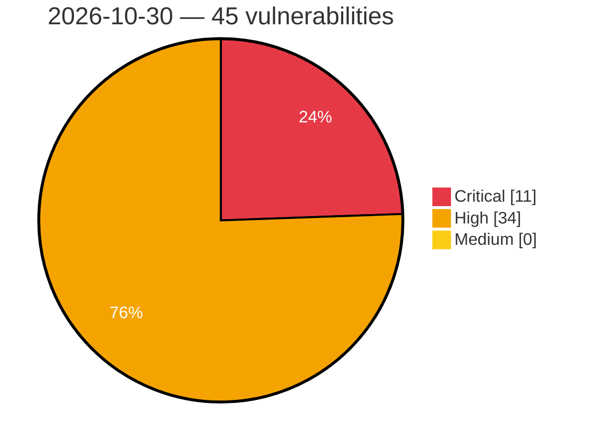

# Critical, High & Medium Severity Vulnerabilities — 2026-10-30

**Source status for this day:**

| Source | Critical | High | Medium | Total |
|--------|---------:|-----:|-------:|------:|
| cvefeed.io (High/Critical) | 11 | 34 | 0 | 45 |

**KEV (actively exploited):** 0  **Watchlist matches:** 27

## Critical (11)

| CVSS | Flags | Source | CVE / Title | Reported |
|------|-------|--------|-------------|----------|
| 10.0 | ⭐ | cvefeed.io (High/Critical) | [CVE-2026-61826 - Bazarr: Plex OAuth API namespace is entirely unauthenticated, allowing config tampering, integration takeover and server-side request forgery](https://cvefeed.io/vuln/detail/CVE-2026-61826) | 30 minutes ago |
| 10.0 | — | cvefeed.io (High/Critical) | [CVE-2026-112816 - Improper certificate validation in the HTTPS listener in LXD](https://cvefeed.io/vuln/detail/CVE-2026-112816) | 30 minutes ago |
| 9.8 | ⭐ | cvefeed.io (High/Critical) | [CVE-2025-31704 - Dahua Intelligent Connection Center command injection](https://cvefeed.io/vuln/detail/CVE-2025-31704) | 1 hour, 1 minute ago |
| 9.8 | ⭐ | cvefeed.io (High/Critical) | [CVE-2026-103039 - Gravity Forms <= 3.1.2 - Unauthenticated PHP Object Injection via Post Custom Field](https://cvefeed.io/vuln/detail/CVE-2026-103039) | 5 hours, 2 minutes ago |
| 9.8 | ⭐ | cvefeed.io (High/Critical) | [CVE-2026-119706 - LMDeploy 0.9.0 through 0.18.0 Unauthenticated RCE via /update_weights Pickle Deserialization](https://cvefeed.io/vuln/detail/CVE-2026-119706) | 1 hour, 29 minutes ago |
| 9.5 | ⭐ | cvefeed.io (High/Critical) | [CVE-2026-116366 - Unauthenticated RCE vulnerability against ClickHouse Server](https://cvefeed.io/vuln/detail/CVE-2026-116366) | 1 hour, 1 minute ago |
| 9.4 | ⭐ | cvefeed.io (High/Critical) | [CVE-2026-82104 - API permission bypass via logic bug](https://cvefeed.io/vuln/detail/CVE-2026-82104) | 4 hours, 1 minute ago |
| 9.2 | — | cvefeed.io (High/Critical) | [CVE-2026-119717 - pybars4 through 0.9.13 Code Injection via Bracketed Path Segments](https://cvefeed.io/vuln/detail/CVE-2026-119717) | 1 hour, 29 minutes ago |
| 9.2 | — | cvefeed.io (High/Critical) | [CVE-2026-119716 - pybars3 through 0.9.7 Code Injection via Bracketed Path Segments](https://cvefeed.io/vuln/detail/CVE-2026-119716) | 1 hour, 29 minutes ago |
| 9.0 | — | cvefeed.io (High/Critical) | [CVE-2026-118697 - JetBrains Toolbox and IntelliJ IDEA Improper Certificate Validation Vulnerability](https://cvefeed.io/vuln/detail/CVE-2026-118697) | 16 minutes ago |
| 9.0 | ⭐ | cvefeed.io (High/Critical) | [CVE-2026-119978 - Flowise through 3.1.4 Custom Function Sandbox Escape RCE via LocalFileStore](https://cvefeed.io/vuln/detail/CVE-2026-119978) | 19 minutes ago |

## High (34)

| CVSS | Flags | Source | CVE / Title | Reported |
|------|-------|--------|-------------|----------|
| 8.8 | ⭐ | cvefeed.io (High/Critical) | [CVE-2026-104368 - Export and Import Users and Customers <= 2.7.5 - Authenticated (Subscriber+) Privilege Escalation via CSV Escape-Character Mismatch in Export/Import Round Trip via Biographical Info Field](https://cvefeed.io/vuln/detail/CVE-2026-104368) | 1 hour, 52 minutes ago |
| 8.8 | ⭐ | cvefeed.io (High/Critical) | [CVE-2026-111505 - Dell OpenManage Enterprise OS Command Injection Vulnerability](https://cvefeed.io/vuln/detail/CVE-2026-111505) | 32 minutes ago |
| 8.8 | ⭐ | cvefeed.io (High/Critical) | [CVE-2026-119420 - Lago through 1.55.0 Authentication Bypass via acceptInvite GraphQL Mutation](https://cvefeed.io/vuln/detail/CVE-2026-119420) | 47 minutes ago |
| 8.8 | ⭐ | cvefeed.io (High/Critical) | [CVE-2026-119408 - n8n before 2.42.6, 2.43.3 and 3.0.1 Code Execution Outside Task Runner Isolation via Deprecated Function Nodes](https://cvefeed.io/vuln/detail/CVE-2026-119408) | 47 minutes ago |
| 8.8 | ⭐ | cvefeed.io (High/Critical) | [CVE-2026-59387 - Broken access control restriction in Cloud Controller API](https://cvefeed.io/vuln/detail/CVE-2026-59387) | 3 hours, 1 minute ago |
| 8.8 | — | cvefeed.io (High/Critical) | [CVE-2026-89435 - Formidable Forms <= 6.35 - Authenticated (Subscriber+) Arbitrary Plugin Installation via 'file_url' Parameter](https://cvefeed.io/vuln/detail/CVE-2026-89435) | 5 hours, 2 minutes ago |
| 8.8 | ⭐ | cvefeed.io (High/Critical) | [CVE-2026-65566 - WordPress AI Engine plugin <= 3.8.8 - Cross Site Request Forgery (CSRF) vulnerability](https://cvefeed.io/vuln/detail/CVE-2026-65566) | 30 minutes ago |
| 8.8 | ⭐ | cvefeed.io (High/Critical) | [CVE-2026-105894 - Ak Framework <= 2.9.8 - Authenticated (Subscriber+) Missing Authorization to Arbitrary Options Update](https://cvefeed.io/vuln/detail/CVE-2026-105894) | 32 minutes ago |
| 8.8 | ⭐ | cvefeed.io (High/Critical) | [CVE-2026-119713 - Paperclip 2026.403.0 before 2026.416.0 RCE via Execution Workspace Cleanup Commands](https://cvefeed.io/vuln/detail/CVE-2026-119713) | 1 hour, 29 minutes ago |
| 8.7 | ⭐ | cvefeed.io (High/Critical) | [CVE-2026-85268 - Cross-Site Scripting (XSS) in Firebase Auth Handler via Malicious Bundle ID](https://cvefeed.io/vuln/detail/CVE-2026-85268) | 1 hour, 1 minute ago |
| 8.7 | — | cvefeed.io (High/Critical) | [CVE-2026-22110 - Missing authentication check on POST/PUT requests](https://cvefeed.io/vuln/detail/CVE-2026-22110) | 1 hour, 1 minute ago |
| 8.7 | — | cvefeed.io (High/Critical) | [CVE-2026-22105 - Use of default password based on serial number](https://cvefeed.io/vuln/detail/CVE-2026-22105) | 1 hour, 1 minute ago |
| 8.7 | ⭐ | cvefeed.io (High/Critical) | [CVE-2026-119116 - Use-after-free in the SetClient command handler of kmstool-enclave in AWS aws-nitro-enclaves-sdk-c](https://cvefeed.io/vuln/detail/CVE-2026-119116) | 30 minutes ago |
| 8.7 | — | cvefeed.io (High/Critical) | [CVE-2025-8574 - Database Cleaner <= 1.4.7 - Authenticated (Administrator+) Arbitrary Table Deletion](https://cvefeed.io/vuln/detail/CVE-2025-8574) | 32 minutes ago |
| 8.6 | — | cvefeed.io (High/Critical) | [CVE-2026-110972 - Use of Client-Side Authentication in Płatnik](https://cvefeed.io/vuln/detail/CVE-2026-110972) | 21 minutes ago |
| 8.5 | — | cvefeed.io (High/Critical) | [CVE-2026-119722 - Blender before 4.5.15 and 5.x before 5.2.3 Heap Out-of-Bounds Access via read_struct()](https://cvefeed.io/vuln/detail/CVE-2026-119722) | 1 hour, 29 minutes ago |
| 8.5 | — | cvefeed.io (High/Critical) | [CVE-2026-119719 - Blender before 4.5.15 and 5.x before 5.2.3 Heap Buffer Overflow via Thumbnail Extraction](https://cvefeed.io/vuln/detail/CVE-2026-119719) | 1 hour, 29 minutes ago |
| 8.5 | — | cvefeed.io (High/Critical) | [CVE-2026-119718 - Blender before 4.5.15 and 5.x before 5.2.3 Heap Buffer Overflow via Point Cache](https://cvefeed.io/vuln/detail/CVE-2026-119718) | 1 hour, 29 minutes ago |
| 8.5 | — | cvefeed.io (High/Critical) | [CVE-2026-104067 - Scribus before 1.6.7 Out-of-Bounds Memory Access via SVM Import Plugin](https://cvefeed.io/vuln/detail/CVE-2026-104067) | 1 hour, 30 minutes ago |
| 8.5 | — | cvefeed.io (High/Critical) | [CVE-2026-104066 - Scribus before 1.6.7 Heap Buffer Overflow via PICT 4-bit Pixel Unpacking](https://cvefeed.io/vuln/detail/CVE-2026-104066) | 1 hour, 30 minutes ago |
| 8.5 | — | cvefeed.io (High/Critical) | [CVE-2026-104065 - Scribus before 1.6.7 Heap Out-of-Bounds Write via Micrografx Draw Import](https://cvefeed.io/vuln/detail/CVE-2026-104065) | 1 hour, 30 minutes ago |
| 8.4 | ⭐ | cvefeed.io (High/Critical) | [CVE-2025-68394 - SQL Injection in Protectel](https://cvefeed.io/vuln/detail/CVE-2025-68394) | 40 minutes ago |
| 8.4 | ⭐ | cvefeed.io (High/Critical) | [CVE-2025-68393 - SQL Injection in Protectel](https://cvefeed.io/vuln/detail/CVE-2025-68393) | 40 minutes ago |
| 8.4 | — | cvefeed.io (High/Critical) | [CVE-2026-22109 - Default WebUI passwords stored in plaintext](https://cvefeed.io/vuln/detail/CVE-2026-22109) | 1 hour, 1 minute ago |
| 8.3 | ⭐ | cvefeed.io (High/Critical) | [CVE-2026-115642 - OpenStack Keystonemiddleware Privilege Escalation Vulnerability](https://cvefeed.io/vuln/detail/CVE-2026-115642) | 30 minutes ago |
| 8.2 | ⭐ | cvefeed.io (High/Critical) | [CVE-2026-14467 - Display of information in the Forocoches comments editor](https://cvefeed.io/vuln/detail/CVE-2026-14467) | 2 hours, 1 minute ago |
| 8.2 | — | cvefeed.io (High/Critical) | [CVE-2026-119086 - Missing type validation in xQueueSelectFromSet in FreeRTOS-Kernel](https://cvefeed.io/vuln/detail/CVE-2026-119086) | 13 minutes ago |
| 8.2 | ⭐ | cvefeed.io (High/Critical) | [CVE-2026-119148 - Unvalidated parent-supplied AWS Region in AWS aws-nitro-enclaves-sdk-c allows impersonation of the enclave's AWS KMS endpoint](https://cvefeed.io/vuln/detail/CVE-2026-119148) | 30 minutes ago |
| 8.1 | ⭐ | cvefeed.io (High/Critical) | [CVE-2026-119419 - CakePHP through 5.4.3 SQL Injection via StringExpression and IdentifierExpression Collation](https://cvefeed.io/vuln/detail/CVE-2026-119419) | 47 minutes ago |
| 8.1 | ⭐ | cvefeed.io (High/Critical) | [CVE-2026-119418 - CakePHP through 5.4.3 SQL Injection via WindowExpression range() and frame()](https://cvefeed.io/vuln/detail/CVE-2026-119418) | 47 minutes ago |
| 8.1 | ⭐ | cvefeed.io (High/Critical) | [CVE-2026-61804 - myTinyWMS has Stored Cross-Site Scripting (XSS) in Product and Category Management](https://cvefeed.io/vuln/detail/CVE-2026-61804) | 30 minutes ago |
| 8.1 | ⭐ | cvefeed.io (High/Critical) | [CVE-2026-115346 - Avada \| Website Builder For WordPress & WooCommerce <= 7.16.2 - Unauthenticated Arbitrary File Upload via Avada Form Upload Field](https://cvefeed.io/vuln/detail/CVE-2026-115346) | 32 minutes ago |
| 8.0 | — | cvefeed.io (High/Critical) | [CVE-2026-118696 - JetBrains IDEs Embedded Browser Certificate Validation Vulnerability](https://cvefeed.io/vuln/detail/CVE-2026-118696) | 16 minutes ago |
| 8.0 | ⭐ | cvefeed.io (High/Critical) | [CVE-2026-119287 - Zuke: Command-form registry descriptors bypass the MCP launch policy](https://cvefeed.io/vuln/detail/CVE-2026-119287) | 1 hour, 29 minutes ago |
