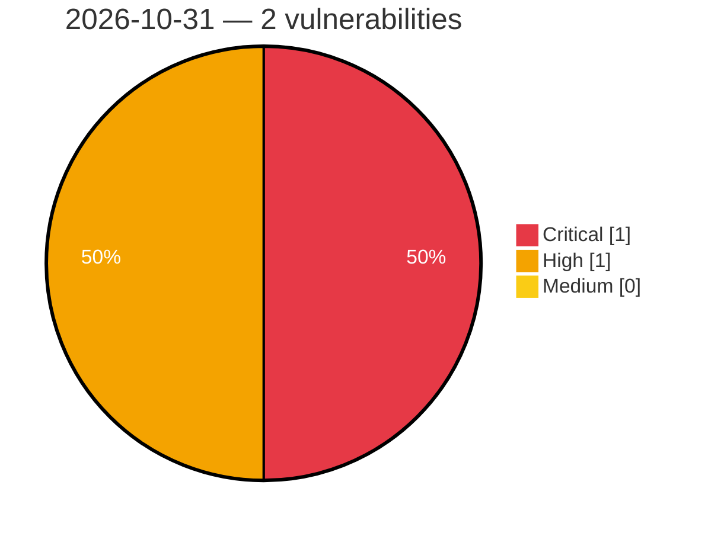

# Critical, High & Medium Severity Vulnerabilities — 2026-10-31

**Source status for this day:**

| Source | Critical | High | Medium | Total |
|--------|---------:|-----:|-------:|------:|
| cvefeed.io (High/Critical) | 1 | 1 | 0 | 2 |

**KEV (actively exploited):** 0  **Watchlist matches:** 1

## Critical (1)

| CVSS | Flags | Source | CVE / Title | Reported |
|------|-------|--------|-------------|----------|
| 9.3 | — | cvefeed.io (High/Critical) | [CVE-2026-117656 - Unverified Sign in with Apple callback parameter can override verified ID token claims](https://cvefeed.io/vuln/detail/CVE-2026-117656) | 1 hour, 31 minutes ago |

## High (1)

| CVSS | Flags | Source | CVE / Title | Reported |
|------|-------|--------|-------------|----------|
| 8.7 | ⭐ | cvefeed.io (High/Critical) | [CVE-2026-110176 - File Force Download for Drupal 7 Access Bypass via Unconditional Download Headers](https://cvefeed.io/vuln/detail/CVE-2026-110176) | 31 minutes ago |
