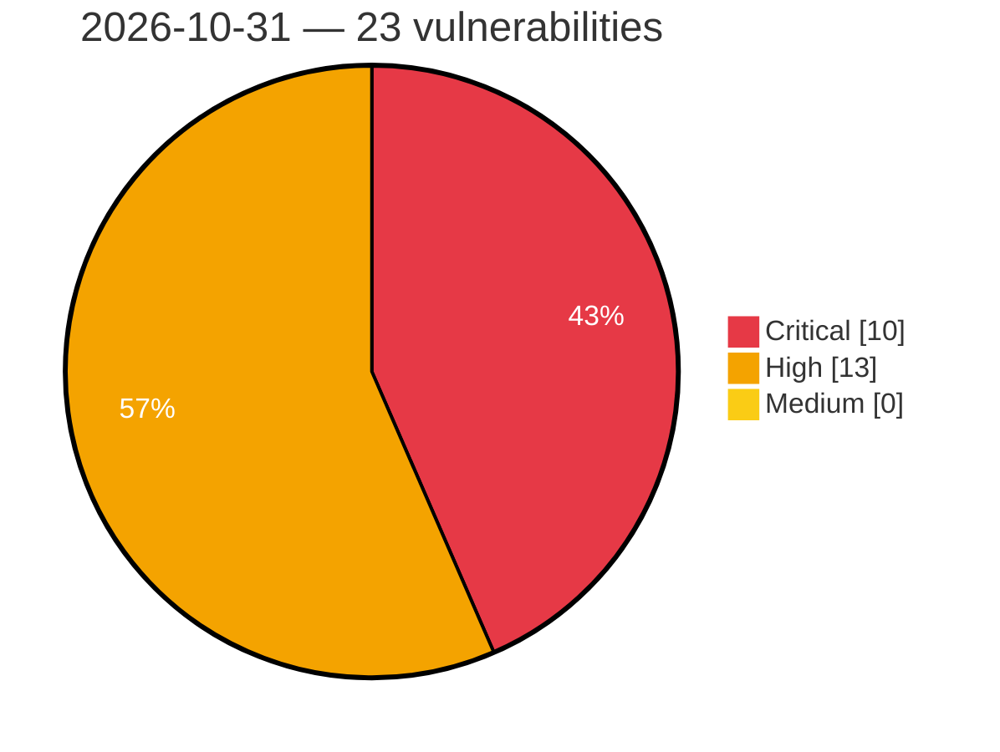

# Critical, High & Medium Severity Vulnerabilities — 2026-10-31

**Source status for this day:**

| Source | Critical | High | Medium | Total |
|--------|---------:|-----:|-------:|------:|
| cvefeed.io (High/Critical) | 10 | 13 | 0 | 23 |

**KEV (actively exploited):** 0  **Watchlist matches:** 19

## Critical (10)

| CVSS | Flags | Source | CVE / Title | Reported |
|------|-------|--------|-------------|----------|
| 9.8 | ⭐ | cvefeed.io (High/Critical) | [CVE-2026-118235 - SimpleForm <= 3.10.2 - Unauthenticated Arbitrary File Upload via Trailing-Dot Filename via Unknown File Key in simpleform_get_submit_data](https://cvefeed.io/vuln/detail/CVE-2026-118235) | 5 hours, 2 minutes ago |
| 9.8 | ⭐ | cvefeed.io (High/Critical) | [CVE-2026-119096 - Uncanny Toolkit for LearnDash <= 3.8.2 - Unauthenticated Authentication Bypass via 'email' Parameter](https://cvefeed.io/vuln/detail/CVE-2026-119096) | 6 hours, 2 minutes ago |
| 9.8 | ⭐ | cvefeed.io (High/Critical) | [CVE-2026-116512 - Project Manager <= 4.1.1 - Unauthenticated Remote Code Execution via 'id' Parameter Function Injection](https://cvefeed.io/vuln/detail/CVE-2026-116512) | 6 hours, 2 minutes ago |
| 9.8 | ⭐ | cvefeed.io (High/Critical) | [CVE-2026-109220 - PDF Invoice for WooCommerce + Drag and Drop Template Builder <= 7.1.1 - Unauthenticated PHP Object Injection to Remote Code Execution via 'customer_note' Checkout Field](https://cvefeed.io/vuln/detail/CVE-2026-109220) | 7 hours, 2 minutes ago |
| 9.8 | ⭐ | cvefeed.io (High/Critical) | [CVE-2026-120209 - AJ-Report through 1.7.1 Authentication Bypass leading to RCE via Share-Token](https://cvefeed.io/vuln/detail/CVE-2026-120209) | 53 minutes ago |
| 9.8 | ⭐ | cvefeed.io (High/Critical) | [CVE-2026-120201 - Jpom 2.10.0 through 2.11.12 Authentication Bypass via JPOM-USER-TOKEN Header](https://cvefeed.io/vuln/detail/CVE-2026-120201) | 53 minutes ago |
| 9.3 | — | cvefeed.io (High/Critical) | [CVE-2026-117656 - Unverified Sign in with Apple callback parameter can override verified ID token claims](https://cvefeed.io/vuln/detail/CVE-2026-117656) | 1 hour, 31 minutes ago |
| 9.1 | ⭐ | cvefeed.io (High/Critical) | [CVE-2026-103882 - Acadlix LMS <= 1.1.9 - Unauthenticated Arbitrary File Deletion via 'delete_file_data.file_path' Parameter](https://cvefeed.io/vuln/detail/CVE-2026-103882) | 5 hours, 2 minutes ago |
| 9.1 | — | cvefeed.io (High/Critical) | [CVE-2026-89270 - Popup Builder <= 4.4.5 - Missing Authorization to Unauthenticated Arbitrary Popup Post Trashing via 'post_type' and 'sg_popup_preview_id' Parameters](https://cvefeed.io/vuln/detail/CVE-2026-89270) | 7 hours, 2 minutes ago |
| 9.1 | — | cvefeed.io (High/Critical) | [CVE-2026-116557 - WP Booking System <= 2.1.0.5 - Missing Authorization to Unauthenticated Arbitrary Calendar Note Deletion via wpbs_calendar_remove_note AJAX Action](https://cvefeed.io/vuln/detail/CVE-2026-116557) | 7 hours, 2 minutes ago |

## High (13)

| CVSS | Flags | Source | CVE / Title | Reported |
|------|-------|--------|-------------|----------|
| 8.8 | ⭐ | cvefeed.io (High/Critical) | [CVE-2026-76010 - Photo Gallery, Sliders, Proofing and Themes – NextGEN Gallery <= 4.4.1 - Authenticated (Custom+) Remote Code Execution via XML-RPC 'meta_data' Mass Assignment and Path Traversal](https://cvefeed.io/vuln/detail/CVE-2026-76010) | 4 hours, 2 minutes ago |
| 8.8 | ⭐ | cvefeed.io (High/Critical) | [CVE-2026-116086 - Konflux-ci: jq filter injection in github workflow issue management](https://cvefeed.io/vuln/detail/CVE-2026-116086) | 5 hours, 2 minutes ago |
| 8.8 | ⭐ | cvefeed.io (High/Critical) | [CVE-2026-120070 - User Frontend <= 4.3.13 - Authenticated (Subscriber+) Privilege Escalation via post_content Parameter](https://cvefeed.io/vuln/detail/CVE-2026-120070) | 6 hours, 2 minutes ago |
| 8.8 | ⭐ | cvefeed.io (High/Critical) | [CVE-2026-104012 - Rox Appointment Booking <= 1.3.1 - Unauthenticated Privilege Escalation via Mass Assignment to Mass Assignment via '/public/booking' Endpoint](https://cvefeed.io/vuln/detail/CVE-2026-104012) | 6 hours, 2 minutes ago |
| 8.8 | ⭐ | cvefeed.io (High/Critical) | [CVE-2026-120203 - ShowDoc 2.8.14 before 3.9.6 Code Injection via Mock Templates](https://cvefeed.io/vuln/detail/CVE-2026-120203) | 53 minutes ago |
| 8.7 | ⭐ | cvefeed.io (High/Critical) | [CVE-2026-110176 - File Force Download for Drupal 7 Access Bypass via Unconditional Download Headers](https://cvefeed.io/vuln/detail/CVE-2026-110176) | 31 minutes ago |
| 8.6 | ⭐ | cvefeed.io (High/Critical) | [CVE-2026-114217 - Konflux-ci: github token plaintext exposure in ci/cd scripts](https://cvefeed.io/vuln/detail/CVE-2026-114217) | 5 hours, 2 minutes ago |
| 8.4 | ⭐ | cvefeed.io (High/Critical) | [CVE-2026-116964 - Konflux-ci: remote code execution via eval() in manifest scripts](https://cvefeed.io/vuln/detail/CVE-2026-116964) | 5 hours, 2 minutes ago |
| 8.4 | — | cvefeed.io (High/Critical) | [CVE-2026-102212 - Pre-Auth Heap Buffer Overflow in the Multipart Request](https://cvefeed.io/vuln/detail/CVE-2026-102212) | 2 hours, 2 minutes ago |
| 8.1 | ⭐ | cvefeed.io (High/Critical) | [CVE-2026-119977 - WordPress Core 4.7.0 - 7.1.3 - Unauthenticated Upgrade-Window Staged-Installer Remote Code Execution](https://cvefeed.io/vuln/detail/CVE-2026-119977) | 57 minutes ago |
| 8.1 | ⭐ | cvefeed.io (High/Critical) | [CVE-2026-103898 - Wp Social Login and Register Social Counter <= 3.2.2 - Unauthenticated Authentication Bypass via Insufficient Email Verification in Social Login Callback](https://cvefeed.io/vuln/detail/CVE-2026-103898) | 6 hours, 2 minutes ago |
| 8.0 | ⭐ | cvefeed.io (High/Critical) | [CVE-2026-117681 - Konflux-ci: ui proxy skips backend tls verification on non-openshift clusters, leaking a token that can impersonate anyone](https://cvefeed.io/vuln/detail/CVE-2026-117681) | 5 hours, 2 minutes ago |
| 8.0 | ⭐ | cvefeed.io (High/Critical) | [CVE-2026-120205 - Thelia before 3.1.0 Stored XSS via Coupon Condition Customer Name](https://cvefeed.io/vuln/detail/CVE-2026-120205) | 53 minutes ago |
